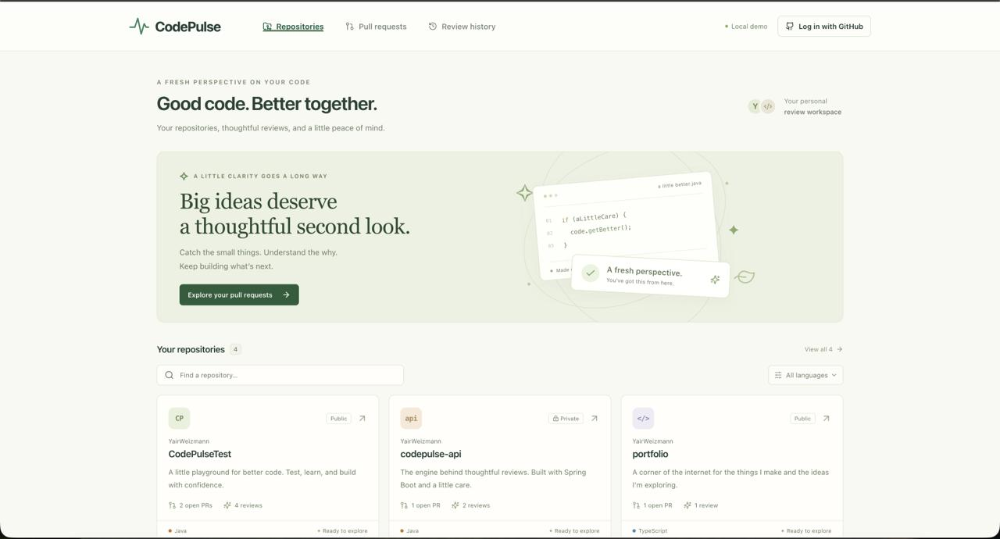
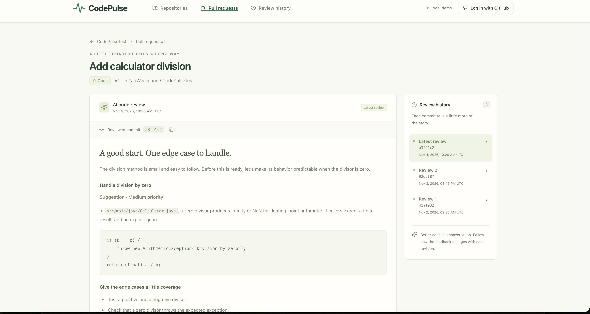

# CodePulse

**AI-Powered GitHub Code Review Platform | In Development**

CodePulse is a code review application built with Java and Spring Boot. It integrates with GitHub to automatically analyze pull requests, identify potential bugs and security issues, and generate actionable feedback using OpenAI.

## Overview

CodePulse is designed to make code reviews more accessible and efficient by providing AI-generated feedback on GitHub pull requests.

When a pull request is opened, the backend retrieves the code changes, analyzes them using OpenAI, and stores the review results in PostgreSQL.

Users can access their repositories, pull requests, and previous reviews through GitHub authentication.

## Features

- **Automated Code Reviews:** Analyze GitHub pull requests using OpenAI.
- **GitHub Integration:** Process pull request events through GitHub Webhooks and REST APIs.
- **Code Analysis:** Identify potential bugs, security vulnerabilities, and runtime issues.
- **Review History:** Store AI-generated reviews and track them by pull request and commit.
- **Authentication:** GitHub OAuth 2.0 integration using Spring Security.
- **Data Persistence:** Store repositories, pull requests, and review results in PostgreSQL.

## Backend Architecture

The backend uses Spring Boot to handle GitHub events, communicate with external APIs, and manage review data.

**Review Workflow:**

1. GitHub sends a webhook when a pull request is opened or reopened.
2. Spring Boot retrieves the changed code through the GitHub REST API.
3. OpenAI analyzes the changes and generates review feedback.
4. The review is saved in PostgreSQL, associated with the pull request and commit.
5. Authenticated users can retrieve their repositories and review history through REST APIs.

## Tech Stack

- **Language:** Java 21
- **Framework:** Spring Boot
- **Database:** PostgreSQL
- **ORM:** Spring Data JPA / Hibernate
- **AI Integration:** Spring AI, OpenAI API
- **Authentication:** Spring Security, GitHub OAuth 2.0
- **Integrations:** GitHub REST API, GitHub Webhooks
- **Database Migrations:** Flyway
- **Build Tool:** Maven

## Screenshots

### Landing Page

### Repository Dashboard

### AI-Powered Pull Request Review

## Development Status

CodePulse is currently under active development, with ongoing improvements to its backend, GitHub integration, and code review workflow.
